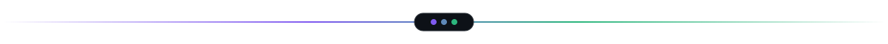

<!-- ============ HEADER ============ -->
<p align="center">
  
</p>

<p align="center">
  <a href="https://my-portfolio-peach-omega-53.vercel.app"></a>
  <a href="https://linkedin.com/in/juanherreramu%C3%B1oz"></a>
  <a href="https://x.com/1juanherrera2"></a>
</p>

---

## 👨‍💻 Sobre mí

```ts
const juan = {
  rol: "Full Stack Developer · Automation & AI",
  ubicacion: "Colombia 🇨🇴",
  especialidad: ["Automatización de procesos", "Integración con ERPs", "Agentes de IA"],
  stack: ["TypeScript", "React", "Node.js", "WordPress", "Python"],
  aprendiendo: ["NestJS", "Arquitecturas backend", "Ingeniería agéntica"],
  aficiones: ["⚽ Fútbol", "🎮 Videojuegos"],
};
```

- ⚙️ Soy el **referente de automatizaciones** en mi empresa: flujos con **n8n**, integraciones con **ERPs**, servicios en la nube y procesamiento inteligente de documentos.
- 🤖 Trabajo a diario con el ecosistema de IA (**Claude Code, Gemini, GCP**) y estoy en transición hacia **AI Engineering**.
- 🧩 Construyo aplicaciones web completas: frontend (mi base más fuerte), backend y sitios **WordPress** a medida con integraciones a sistemas internos.
- 🎨 Cuido el diseño: trabajo en **Figma** y aplico design systems a productos internos.

---

## 🛠️ Stack

**Lenguajes & Frontend**

<p>
  
</p>

**Backend, datos & CMS**

<p>
  
</p>

**Cloud, DevOps & herramientas**

<p>
  
</p>

**Automatización & IA**

<p>
  
  
  
  
  
</p>

---

<!-- ============ PROYECTOS ============
  Para actualizar: reemplaza o agrega filas en la tabla.
  Formato: | emoji **Nombre** | Descripción corta (1 línea). |
-->
## 🚀 Lo que he construido

| Proyecto | Descripción |
| --- | --- |
| 🛃 **Suite de automatizaciones aduaneras** | Flujos n8n que conectan ERPs, nube y sistemas internos para eliminar trabajo manual en operaciones de aduana. |
| 📄 **Extracción inteligente de facturas** | Pipeline IDP/OCR que lee facturas de importación con IA y las integra al ERP. |
| 🎨 **Sistema de inventario y formulación de pinturas** | Plataforma para gestionar inventario, fórmulas y producción de una fábrica de pinturas. |
| 🌐 **Sitios WordPress con integraciones** | Webs corporativas del grupo con desarrollo a medida y conexión a sistemas internos. |

> 📂 Todos mis proyectos están en **[mi portafolio](https://my-portfolio-peach-omega-53.vercel.app)**.
<!-- ============ FIN PROYECTOS ============ -->

<!-- ============ FOOTER ============ -->
<p align="center">
  
</p>
